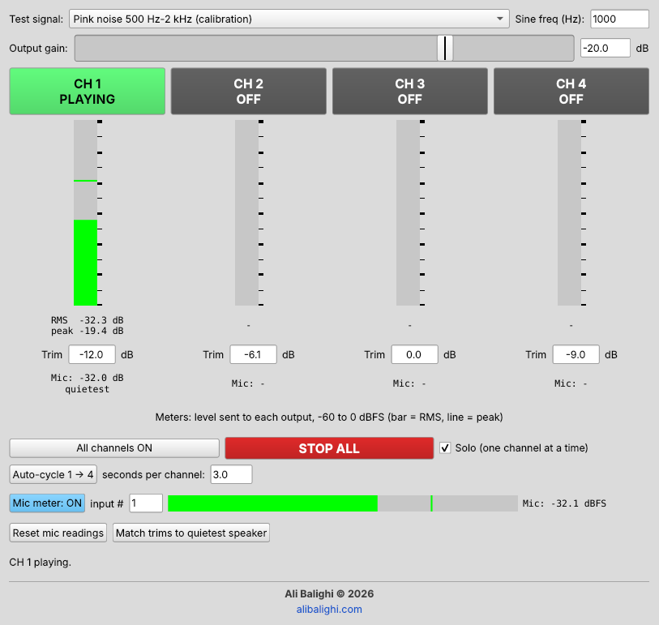

# Speaker Loudness Tester

A 4-channel speaker loudness tester for SuperCollider. Play pink noise, white noise, sine tones or sweeps on each speaker separately or together, watch the level meters, and balance your speakers with per-channel trims, auto-cycle and optional mic-based auto-matching.



## Features

- **Test each speaker on its own.** CH 1–4 buttons, with a Solo mode so only one channel plays at a time.
- **Five test signals:** full-range pink noise, band-limited pink noise (500 Hz–2 kHz, for calibration), white noise, a sine tone with adjustable frequency, and a 20 Hz–20 kHz sine sweep.
- **Level meters** for every output, showing RMS and peak in dBFS.
- **Per-channel trims** from -30 to +10 dB, plus an output gain control.
- **Auto-cycle** through 1 → 2 → 3 → 4, with an adjustable time per channel.
- **Optional mic auto-matching.** Measures each speaker through a microphone and sets the trims for you.
- **Safety:** starts at -30 dB, with a limiter that keeps the output at or below -1 dBFS.

## Requirements

- [SuperCollider](https://supercollider.github.io/) (tested with 3.13)
- An audio interface with at least 4 outputs
- Optional: an SPL meter (a phone app works) or a measurement microphone

## Getting started

1. Open `speaker_loudness_tester.scd` in the SuperCollider IDE.
2. Click anywhere inside the big `( ... )` block.
3. Press **Cmd+Return** (macOS) or **Ctrl+Return** (Windows / Linux).

The audio server boots with 4 outputs and the tester window opens. If the server is already running with fewer than 4 outputs, the script reboots it for you.

### Choosing your audio interface

If your 4-channel interface isn't the system default, list the available devices:

```supercollider
ServerOptions.devices.postln;
```

Then add this line before running the script:

```supercollider
s.options.device = "Your Interface Name";
```

## How to use

### Match speakers by ear or with an SPL meter

1. Choose **Pink noise 500 Hz–2 kHz (calibration)**.
2. Raise the output gain slowly to about **-20 dB**. For the noise signals, the gain equals the RMS level in dBFS, so -20 dB gives the standard -20 dBFS calibration level. Sine signals peak at the gain setting.
3. Play each channel and read the SPL meter at your listening position.
4. Adjust each channel's **Trim** until all four speakers read the same.

### Match speakers automatically with a microphone

1. Connect a measurement mic to your audio interface and place it at the listening position.
2. Set the mic **input #** and turn on **Mic meter**.
3. Press **Auto-cycle** and let it play through all four channels at least once.
4. Press **Match trims to quietest speaker**. Each louder speaker is turned down to match the quietest one.
5. Run Auto-cycle again to check. The readings under each channel should now be equal.

Keep the mic in the same position for all four speakers. Changing the gain or test signal clears all mic readings, and changing a trim clears that channel's reading, so measure again after a change.

## Controls

| Control | What it does |
| --- | --- |
| Test signal | Chooses the sound played on the speakers |
| Sine freq (Hz) | Frequency of the sine tone (20–20,000 Hz) |
| Output gain | Overall level, -80 to 0 dB |
| CH 1–4 | Turns each speaker on or off |
| Trim | Per-channel level adjustment, -30 to +10 dB |
| All channels ON | Plays all four speakers together |
| STOP ALL | Stops all sound |
| Solo | When ticked, only one channel plays at a time |
| Auto-cycle | Plays each channel in turn |
| Mic meter | Turns on the microphone input meter |
| Reset mic readings | Clears the measured mic levels |
| Match trims | Sets trims from the mic readings |

Closing the window, or pressing **Cmd/Ctrl + Period**, stops all sound.

## Settings

You can change these at the top of the script:

```supercollider
var numCh     = 4;      // number of speakers to test
var numInputs = 2;      // hardware inputs to open (for the mic)
var startDb   = -30;    // starting output gain in dB
var sweepTime = 6;      // seconds per sine sweep
```

## Notes

- The on-screen meters show the level SuperCollider sends to each output. The actual loudness in the room depends on your amplifiers and speakers, so measure it with an SPL meter or a microphone.
- On Linux, connect SuperCollider's outputs to your interface in JACK if they don't connect automatically.

## Author

**Ali Balighi** © 2026
[alibalighi.com](https://alibalighi.com)
